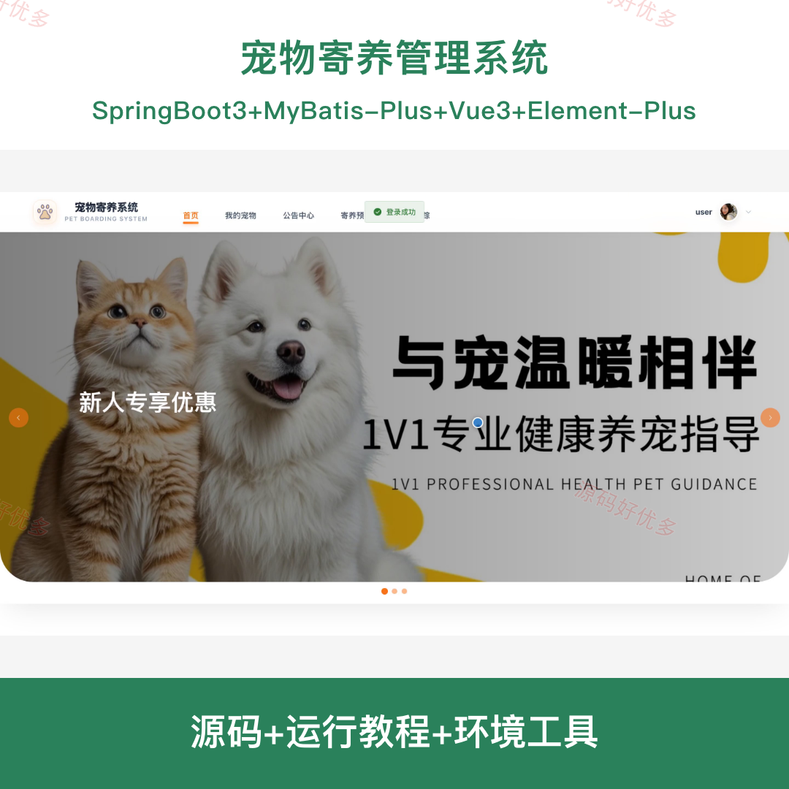
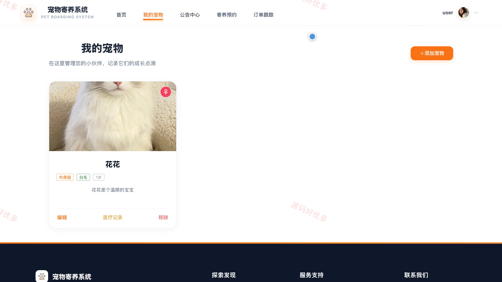
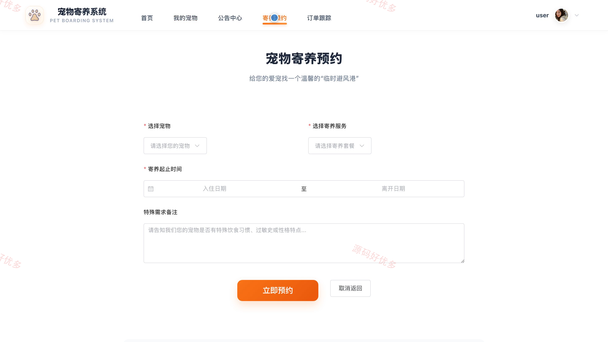
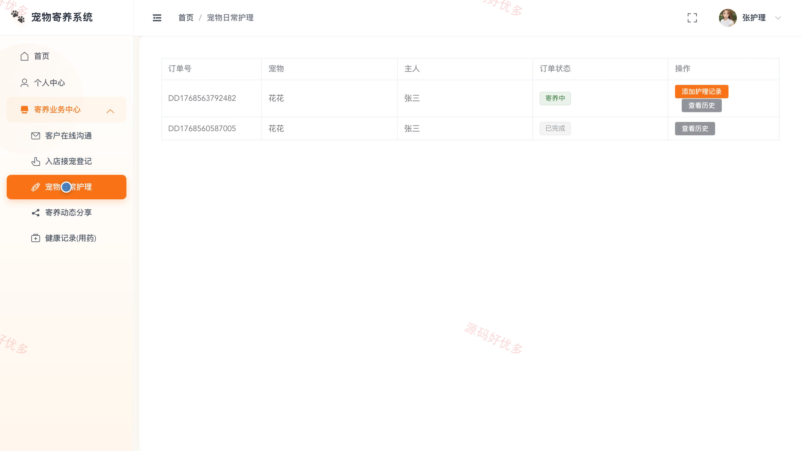
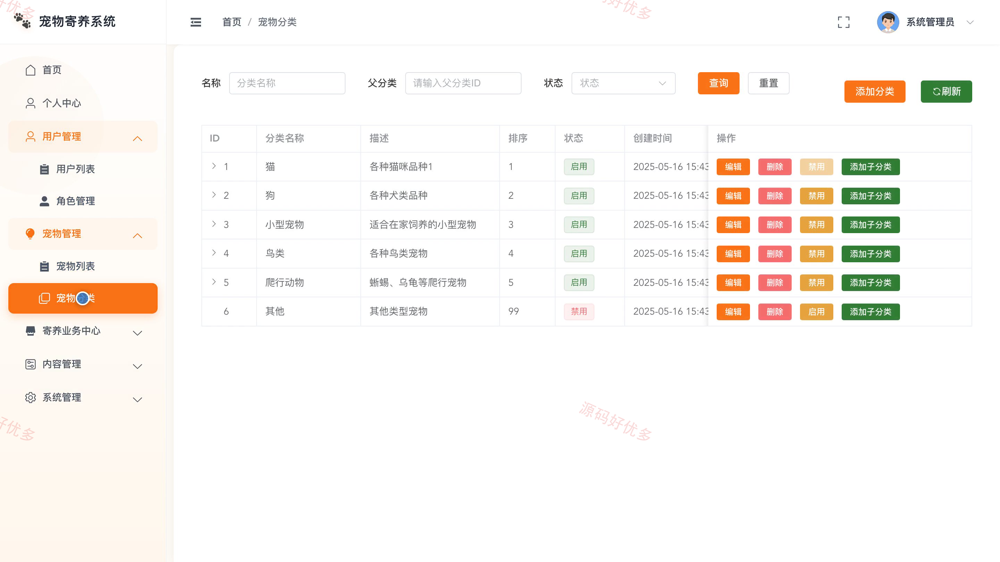
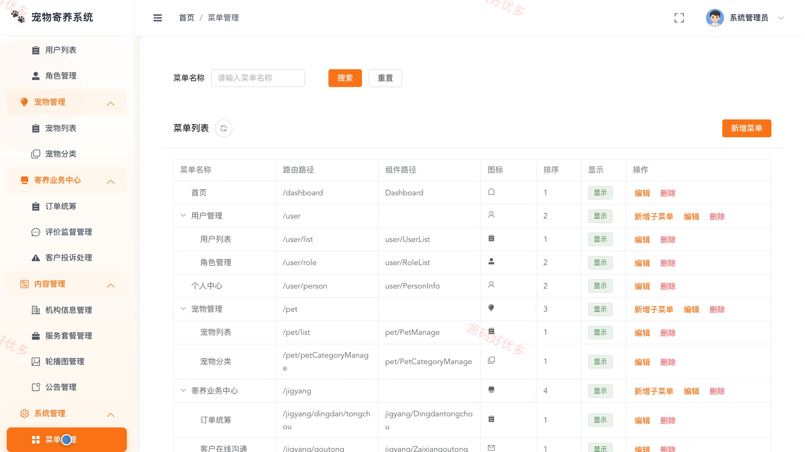

# bs129A
bs129A宠物寄养管理系统源码 Java SpringBoot3 Vue3 前后分离
## 源码问题查看主页咨询

### 一、关键词
宠物寄养、宠物托管、寄养预约、宠物护理、宠物住宿

### 二、作品包含
源码+数据库+全套环境和工具资源+本地部署教程

### 三、项目技术
前端技术： Html、Css、Js、Vue3.2、Element-Plus
后端技术：Java、SpringBoot3.2.0、MyBatis-Plus

### 四、运行环境要求
开发工具：IDEA/eclipse + VSCODE

数据库：MySQL5.7+（共18张表）

数据库管理工具：Navicat10以上版本

环境配置软件： JDK17 + Maven3.6

前端Nodejs：16+

浏览器：谷歌浏览器

### 五、项目介绍
项目编号：bs129A

面向宠物主人、护理员和管理员的寄养服务平台，提供宠物档案、寄养预约、订单跟踪、日常护理、健康记录和客户沟通等功能。

角色：用户、宠物护理员、管理员

用户功能：浏览宠物与寄养服务、管理个人宠物档案、提交寄养预约、跟踪寄养订单、查看公告与个人信息、评价反馈与在线沟通。

宠物护理员功能：登记接宠信息、记录宠物日常护理、分享寄养动态、维护健康用药记录、在线沟通与个人信息管理。

管理员功能：管理用户与角色权限、管理宠物及分类、维护机构信息与服务套餐、统筹寄养预约与订单、处理客户投诉与评价、管理公告与轮播图。

### 六、运行截图

